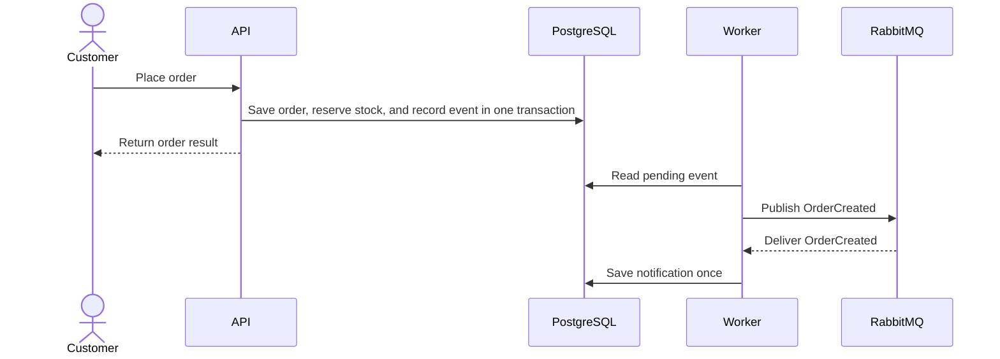

# OIMS — Order & Inventory Management System

OIMS is an order and inventory management system built with ASP.NET Core 10.

## Problems OIMS solves

Consider two customers ordering the last available unit at the same time. One
customer retries after a network timeout, while a background message may also
be delivered more than once. OIMS keeps these events from overselling stock,
creating duplicate orders, or repeating a downstream business effect.

- Order creation and stock reservation commit or roll back together in PostgreSQL.
  Concurrent requests cannot reserve more stock than is available.
- An `Idempotency-Key` lets a client retry the same order request without
  creating another order; a changed request under the same key is rejected.
- Cancellation and reservation expiry release stock. Payment outcomes are
  simulated; successful payment retains the reservation until physical
  fulfillment issues stock.
- Inventory transactions and order or shipment histories record changes.
  Product price changes do not rewrite prices on existing orders.
- Product reads may use Redis, while PostgreSQL remains authoritative. RabbitMQ
  carries order events; durable Outbox intent, bounded retries, and idempotent
  consumption handle publication failures and duplicate delivery.

## System overview

OIMS has two application processes. The API handles requests from customers and
administrators. The Worker handles tasks that continue after an API response.
Both use PostgreSQL to store business data.

Read this order-creation flow from top to bottom:



<!-- The event record in PostgreSQL is the Outbox. It lets the Worker retry
publication if RabbitMQ is unavailable. The Worker also expires unpaid
reservations and reconciles simulated payments. Redis speeds up product reads;
it does not decide whether stock is available. -->

## Run locally with Docker Compose

Install Docker with Compose 2.30 or later, then open PowerShell in the cloned
repository directory (the one containing `compose.yml`). Compose starts the API,
Worker, PostgreSQL, Redis, and RabbitMQ; the `migrate` service applies database
migrations automatically.

### 1. Configure the first run

```powershell
if (-not (Test-Path .env)) { Copy-Item .env.example .env }
notepad .env
```

In `.env`, fill these values with local passwords. Use the same password in
each service's connection value; keep the file out of Git.

```text
OIMS_POSTGRES_PASSWORD=<postgres-password>
OIMS_DATABASE_CONNECTION_STRING=Host=postgres;Port=5432;Database=oims;Username=oims;Password=<postgres-password>
OIMS_REDIS_PASSWORD=<redis-password>
OIMS_REDIS_CONFIGURATION=redis:6379,password=<redis-password>,abortConnect=false
OIMS_RABBITMQ_PASSWORD=<rabbitmq-password>
OIMS_JWT_SIGNING_KEY=<base64-signing-key>
```

Generate a Base64 signing key and paste the output into `OIMS_JWT_SIGNING_KEY`:

```powershell
$jwtBytes = New-Object byte[] 32
$rng = [System.Security.Cryptography.RandomNumberGenerator]::Create()
$rng.GetBytes($jwtBytes)
$rng.Dispose()
[Convert]::ToBase64String($jwtBytes)
```

Save `.env` before continuing.

### 2. Start and check the full stack

```powershell
docker compose config --quiet
docker compose up --build --detach --wait
docker compose ps --all
Invoke-WebRequest http://127.0.0.1:8080/health/ready -UseBasicParsing
Invoke-RestMethod http://127.0.0.1:8080/api/products/
```

`migrate` should finish with exit code `0`; API and Worker stay running in the
background. The readiness request should return HTTP `200`. If startup fails,
inspect the logs:

```powershell
docker compose logs --tail 100 migrate api worker
```

## Optional service checks

These checks are useful for troubleshooting but are not required before
starting the API and Worker.

### Check PostgreSQL with `psql`

Open `psql` from the PostgreSQL container. This does not require PostgreSQL
client tools on Windows:

**Tool: PowerShell (Docker CLI invokes `psql` inside the container)**

```powershell
docker compose exec postgres psql -U oims -d oims
```

Inside the `psql` prompt, `\dt` lists tables and `\q` exits. To verify password
authentication rather than the container's trusted local socket, use:

**Tool: PowerShell (Docker CLI invokes `psql` inside the container)**

```powershell
docker compose exec postgres psql `
  --host postgres `
  --port 5432 `
  --username oims `
  --dbname oims `
  --password
```

Enter `OIMS_POSTGRES_PASSWORD` from `.env` when prompted. The password is not
echoed or placed in command history.

For DBeaver, DataGrip, or pgAdmin use host `127.0.0.1`, port `5433`, database
`oims`, username `oims`, and the password from `.env`.

### Check and configure Redis

Redis is configured with AOF persistence and password authentication. It is an
optimization/cache, not the source of truth for inventory or orders.

Test Redis by invoking `redis-cli` inside the Redis container. This does not
require Redis client tools on Windows:

**Tool: PowerShell (Docker CLI invokes `redis-cli` inside the container)**

```powershell
docker compose exec redis sh -c 'redis-cli --no-auth-warning -a "$REDIS_PASSWORD" ping'
```

Expected response: `PONG`.

### Check and configure RabbitMQ

Open `http://127.0.0.1:15672` and sign in with `OIMS_RABBITMQ_USER` and
`OIMS_RABBITMQ_PASSWORD` from `.env`. Port `15672` is the management UI/API;
applications use AMQP port `5672`.

**Tool: Web browser (RabbitMQ Management UI)**

```text
http://127.0.0.1:15672
```

## Connect from another machine

The default bind address is `127.0.0.1`, so infrastructure is reachable only
from the Docker host. To allow a trusted machine on a private network or VPN,
change this value in `.env`:

**Edit file: `.env` (this is configuration, not a shell command)**

```env
OIMS_INFRA_BIND_ADDRESS=0.0.0.0
```

Then recreate the services:

**Tool: PowerShell (Docker CLI)**

```powershell
docker compose up -d --force-recreate
```

Use the Docker host's private IP instead of `127.0.0.1`, for example:

**Reference only: endpoint examples (do not execute)**

```text
PostgreSQL: 10.0.0.20:5433
Redis:      10.0.0.20:6379
RabbitMQ:   10.0.0.20:5672
Management: http://10.0.0.20:15672
```

Before enabling remote access:

- allow these ports only from specific trusted source IPs in the host and
  network firewall;
- prefer a VPN or SSH tunnel;
- never expose PostgreSQL, Redis, AMQP, or RabbitMQ Management directly to the
  public Internet;
- use TLS and a managed secret store for a real production deployment.

Test reachability from the client machine:

**Tool: PowerShell on the client machine**

```powershell
Test-NetConnection <DOCKER_HOST_IP> -Port 5433
Test-NetConnection <DOCKER_HOST_IP> -Port 6379
Test-NetConnection <DOCKER_HOST_IP> -Port 5672
Test-NetConnection <DOCKER_HOST_IP> -Port 15672
```

## Configuration reference

RabbitMQ queue capacity uses the following Docker Compose variables. The
committed 1 MiB values are deterministic local-development and integration-test
defaults. Production values must be replaced using measured encoded event size,
arrival rate, tolerated outage duration, safety margin, and broker disk capacity.

```text
OIMS_RABBITMQ_MAIN_QUEUE_MAX_LENGTH_BYTES
OIMS_RABBITMQ_RETRY_QUEUE_MAX_LENGTH_BYTES
OIMS_RABBITMQ_DEAD_LETTER_QUEUE_MAX_LENGTH_BYTES
OIMS_RABBITMQ_MAX_MESSAGE_SIZE_BYTES
```

ASP.NET Core environment variables use double underscores:

**Reference only: configuration keys (do not execute)**

```text
Database__ConnectionString
Jwt__Issuer
Jwt__Audience
Jwt__SigningKey             # Base64 for at least 32 random bytes; required to issue/validate JWTs
Authentication__RefreshPermitLimit             # Default 10 per observed IP/window
Authentication__RefreshWindow                  # Default 00:01:00
Authentication__RefreshTokenCleanupInterval    # Default 01:00:00
Authentication__RefreshTokenCleanupBatchSize   # Default 500
Authentication__ExpiredRefreshTokenRetention   # Default 1.00:00:00
AdminBootstrap__Enabled                         # Default false; Development/Test only
AdminBootstrap__Email                           # Required only when enabled
AdminBootstrap__Password                        # Required only when enabled; 8-13 characters
Reservation__Duration                           # Default 00:15:00
Reservation__ExpirationScanInterval             # Worker default 00:01:00
Reservation__BatchSize                          # Worker default 100
Payment__Enabled                                # Default false; enables simulated Payment endpoints
Redis__Configuration
RabbitMq__Host
RabbitMq__Port
RabbitMq__VirtualHost
RabbitMq__Username
RabbitMq__Password
Serilog__FilePath
```

The list above is the repository-wide configuration catalog, not a requirement
that every process receive every value. The API uses database, authentication,
product, order, payment, cache, and messaging settings. The Worker uses database,
reservation, payment reconciliation, Outbox publication, messaging, metrics,
and logging settings.

The simulated Payment module is disabled by default, including in Production.
Set `Payment__Enabled=true` only when exercising the simulated Payment flow.
The fake provider stores its test state in PostgreSQL and uses no real payment
credentials; set it back to `false` when that exercise is complete.

Never commit passwords, signing keys, tokens, or resolved connection strings.
The `.env` file is ignored by Git.

Login returns only the bearer access token and its lifetime in JSON, and sends
the refresh token only as the secure HttpOnly `__Secure-oims-refresh` cookie.
Refresh and logout read that cookie, so local browser testing must use HTTPS.
Access tokens are stateless and are not stored in a deny-list: refresh-token
rotation, detected reuse, or logout blocks future refreshes but does not revoke
an already issued access token before its short expiry.
The default `SameSite=Lax` contract assumes a same-site web deployment;
configure an explicit trusted CORS and cookie policy before placing the
frontend on a cross-site origin.

## Logging

API and Worker use structured Serilog logging to console and file. Files roll
daily and at 10 MiB; rolled files older than 30 days are removed automatically.
Default paths are `logs/oims-api-.log` and `logs/oims-worker-.log`.

HTTP request logs include `TraceId`, `CorrelationId`, and `UserId`.
Authenticated `UserId` is taken only from the trusted `NameIdentifier` or JWT
`sub` claim; unauthenticated requests are logged as `anonymous`. Request bodies,
authorization headers, passwords, tokens, and connection strings are not logged.

The reservation expiration Worker logs lifecycle events, per-scan examined,
expired, skipped, and failed counts, and candidate failures with `OrderId`.
Its `oims.reservation_expiration.orders` counter uses only the bounded
`outcome` values `expired`, `skipped`, and `failed`; it never uses `OrderId` as
a metric tag.

## Verification

**Tool: PowerShell (.NET CLI and Docker CLI)**

```powershell
dotnet restore OrderSystem.slnx
dotnet format OrderSystem.slnx --verify-no-changes --no-restore
dotnet build OrderSystem.slnx --configuration Release --no-restore
dotnet test OrderSystem.slnx --configuration Release --no-build
docker compose config --quiet
```

PostgreSQL integration tests use Testcontainers and require a running Docker
daemon.
